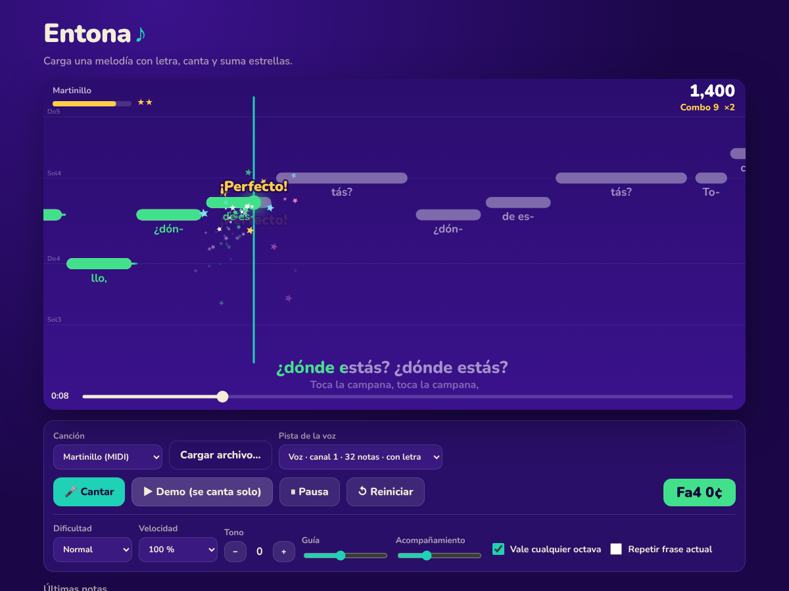

# PitchCoachJS ♪

**Practica a cantar como en un karaoke… pero con alguien que te escucha.**

PitchCoach es una librería JavaScript **vanilla, sin dependencias y sin build**. Carga una melodía con letra (MIDI, KAR, UltraStar o JSON), la dibuja como barras que avanzan, escucha tu voz por el micrófono y te puntúa en tiempo real: la letra se pone verde cuando das la nota, salen estrellas cuando mantienes la afinación y al final recibes nota (S/A/B/C/D) y de 0 a 5 estrellas.



## Probar el ejemplo

**Demo online:** https://palexandre.github.io/PitchCoachJS/example/

```bash
npm run dev          # sirve el repo en http://localhost:5173
# abre http://localhost:5173/example/
```

(Cualquier servidor estático vale; los módulos ES no funcionan abriendo el HTML con `file://`.)

La página de ejemplo es una app completa y responsive (móvil primero):

- **Biblioteca**: canciones de muestra + las que importes (se guardan en el navegador), con tu mejor nota y estrellas.
- **Ficha de canción** (hoja inferior en móvil): duración, notas, tesitura, récord y un resumen de ajustes. **Cantar** pide el micrófono; **Escuchar demo** se canta sola enviando la guía al detector.
- **Partida a pantalla completa**: solo el escenario, la pausa, la nota que estás cantando y la puntuación. Respeta el notch, mantiene la pantalla encendida y se pausa al cambiar de app.
- **Pausa**: continuar, repetir la frase actual en bucle, empezar de nuevo, ajustes o salir. Espacio/Esc también pausan; el botón atrás del móvil sale.
- **Ajustes** (dificultad, velocidad, tono por canción, octava, volúmenes, retraso del micro, Do-Re-Mi/C-D-E, pista de la voz en MIDI) guardados entre sesiones.
- **Resultados** con estrellas animadas, nota, desglose y aviso de nuevo récord.
- **Editor de canciones** («Crear canción», o «Editar» en cualquier canción):
  - **Grabar desde un piano de verdad**: deja el móvil cerca del piano, cuenta atrás de un compás y toca la melodía nota a nota. PitchCoach separa cada nota por el golpe de tecla (así distingue dos notas iguales seguidas) y la ajusta al tempo. No transcribe acordes.
  - Grabar **cantando**, o tocando el **piano de la pantalla** / el teclado del ordenador (`A W S E D F T G Y H U J K`, `Z`/`X` cambian de octava).
  - Escribir nota a nota: elige la duración (semicorchea… redonda), toca una tecla y la nota se añade en el cursor. Toca una nota para seleccionarla, arrástrala para moverla o estira su borde para alargarla.
  - **Letra** como texto normal (`can-ción`, salto de línea = frase nueva) que se reparte sola entre las notas, con contador de sílabas/notas.
  - Escuchar con piano y metrónomo, tempo y compás, deshacer/rehacer, autoguardado del borrador, **Probar cantando** y exportar a **JSON** o **MIDI con letra**.
- Arrastra un `.mid`, `.kar`, `.txt` (UltraStar) o `.json` sobre la página para importarlo.

## Uso básico

```html
<canvas id="stage" style="width:100%;height:480px"></canvas>
<button id="go">Cantar</button>

<script type="module">
  import { PitchCoach, loadSong } from './src/index.js';

  const game = new PitchCoach(document.getElementById('stage'), { difficulty: 'normal' });
  game.load(await loadSong('songs/mi-cancion.mid'));

  document.getElementById('go').onclick = () => game.start(); // pide el micrófono

  game.on('note', (e) => console.log(e.note.lyric, e.rating, e.points));
  game.on('streak', (e) => console.log('¡racha!', e.level));
  game.on('end', (r) => console.log(r.grade, r.stars, r.score));
</script>
```

> `start()` debe llamarse desde un clic (los navegadores solo permiten audio y micrófono tras un gesto del usuario).

## API

### `loadSong(source, opts?) → Promise<Song>`

`source` puede ser un `File`/`Blob`, `ArrayBuffer`/`Uint8Array`, una URL, texto UltraStar/JSON o un objeto JSON. El formato se detecta solo.

| opción | |
|---|---|
| `format` | `'midi' \| 'ultrastar' \| 'json'` para forzarlo |
| `melody` | MIDI: pista de la voz como `"pista:canal"` (ver `song.meta.candidates`) |
| `title` | sobrescribe el título |

### `new PitchCoach(canvas, options?)`

| opción | por defecto | |
|---|---|---|
| `difficulty` | `'normal'` | `'facil'` (±100 cents), `'normal'` (±55), `'dificil'` (±30) |
| `tolerance` | – | cents permitidos; anula `difficulty` |
| `octaveTolerant` | `true` | la nota correcta en otra octava cuenta (voces graves/agudas) |
| `transpose` | `0` | semitonos, para adaptar la canción a tu tesitura |
| `speed` | `1` | `0.6` = practicar más despacio |
| `guideVolume` | `0.35` | volumen de la melodía guía (0 = sin guía) |
| `accompanimentVolume` | `0.18` | resto de pistas del MIDI |
| `latency` | `0.06` | s de retraso del micrófono a compensar |
| `leadIn` | `3` | s de cuenta atrás antes de la primera nota |
| `streakStep` | `2` | s seguidos afinando para subir un nivel de racha |
| `notation` | `'solfege'` | nombres de la rejilla: `'solfege'` (Do4) o `'english'` (C4) |
| `pixelsPerSecond` | `'auto'` | zoom horizontal (px por segundo); `'auto'` se adapta al ancho |
| `insets` | `{}` | `{ top, bottom }` en px reservados para tus barras o el notch |
| `hud`, `lyricsLine`, `results` | `true` | dibujar marcador, frase karaoke y resultados en el canvas |
| `theme`, `labels` | | colores y textos (ver `DEFAULT_THEME`, `DEFAULT_LABELS`) |
| `audioContext` | | comparte el `AudioContext` de tu app |

Pasa `canvas = null` para usar el motor sin gráficos.

**Métodos:** `load(song)`, `start({ input: 'mic' | 'demo' | MediaStream | AudioNode, from })`, `pause()`, `resume()`, `togglePause()`, `stop()`, `seek(seg)`, `setLoop(inicio, fin)` / `setLoop(null)`, `set({ ...opciones })` en caliente, `currentTime`, `state`, `result`, `destroy()`.

**Eventos:**

| evento | datos |
|---|---|
| `note` | `{ note, rating: 'perfect'\|'great'\|'good'\|'miss', accuracy, points, combo, multiplier }` |
| `streak` | `{ seconds, level }` |
| `score` | `{ score, combo, multiplier, percent }` |
| `frame` | `{ time, pitch: { freq, midi, name, cents, hit, note } }` cada fotograma |
| `end` | `{ score, percent, grade, stars, maxCombo, counts }` |
| `load`, `start`, `pause`, `resume`, `seek`, `stop` | |

### Puntuación

- Cada nota mide qué parte de su duración estuviste dentro de la tolerancia (con un 80 % basta para el 100 %, se perdona el ataque).
- `perfect` ≥ 85 %, `great` ≥ 60 %, `good` ≥ 30 %, si no `miss`.
- Puntos = precisión × 100 × peso por duración × multiplicador de combo (×2 a partir de 5 notas, ×3 desde 15, ×4 desde 30). Las notas doradas valen el doble.
- Nota final por afinación media: S ≥ 90 %, A ≥ 80 %, B ≥ 65 %, C ≥ 50 %, D. Estrellas de 0 a 5 en medias estrellas; con un 90 % (una S) ya tienes las 5.

## Piezas sueltas (para otros juegos)

Todo está exportado por separado, así puedes montar otros juegos, por ejemplo **tarjetas de solfeo** del tipo «canta esta nota»:

```js
import { PitchDetector, parsePitch, midiToName } from 'pitchcoach';

const objetivo = parsePitch('Sol4');            // 67
const det = new PitchDetector({ notation: 'solfege' });

det.on('pitch', (p) => {
  if (!p) return;                               // silencio
  const cents = (p.midi - objetivo) * 100;
  tarjeta.textContent = `${p.name} (${Math.round(cents)}¢)`;
  if (Math.abs(cents) < 40) acierto();
});
await det.start();                              // micrófono; det.stop() para soltarlo
```

| export | para qué |
|---|---|
| `PitchDetector` | micrófono → `{ freq, midi, note, name, cents, clarity, volume }`. `start({ loop:false })` + `read()` si prefieres tu propio bucle |
| `yin(buffer, sampleRate)` | el algoritmo de detección, puro |
| `Scorer` | puntuación/combos/rachas sobre cualquier `Song`, sin audio ni canvas |
| `Renderer` | solo el dibujo |
| `Synth` | reproduce la guía y el acompañamiento con Web Audio |
| `parsePitch`, `midiToName`, `midiToFreq`, `freqToMidi` | utilidades de notas (`'Do#4'`, `'Mib3'`, `'C4'`, `'Bb2'`…) |
| `parseMidi`, `midiToSong`, `ultrastarToSong`, `jsonToSong`, `finalizeSong` | lectores de formatos |
| `Piano` | sonido de piano sintetizado (sin muestras): `play(midi, { duration })`, `noteOn/noteOff` |
| `PianoKeyboard` | teclado de piano en pantalla (táctil, glissando, teclado del ordenador) con eventos `noteon`/`noteoff` |
| `Metronome` | metrónomo preciso con acentos por compás |
| `NoteRecorder` | convierte en notas cuantizadas lo que llega de teclas (`noteOn/noteOff`), voz (`pitch`) o un instrumento real por micrófono (`instrument`) |
| `splitLyrics`, `joinLyrics` | letra en texto ⇄ una sílaba por nota |
| `draftToJSON`, `draftToMidi`, `songToDraft`, `writeMidi` | exportar canciones a JSON de PitchCoach o MIDI con letra |

## Formatos de canción

Un MIDI normal no trae letra, así que PitchCoach acepta varios formatos:

### MIDI / KAR con letra
- Letra en eventos **Lyric** (`FF 05`) en el mismo tick que cada nota, o eventos **Text** (`FF 01`) estilo `.kar` (`/` = nueva línea, `\` = párrafo, `@T` = título).
- Elige sola la pista de la voz (la que mejor encaja con la letra) y la deja monofónica; el resto suena como acompañamiento (la batería, canal 10, se ignora). Puedes elegir otra con `{ melody: '2:0' }`.

### UltraStar (`.txt`)
El formato de UltraStar/Vocaluxe/Performous; hay muchas canciones disponibles. `:` normal, `*` dorada, `F` libre, `-` salto de línea, `#RELATIVE` soportado.

```
#TITLE:Estrellita
#BPM:200
#GAP:2000
: 0 7 0 Es
: 8 7 0 tre
: 16 7 7 lli
- 56
```

### JSON de PitchCoach (pensado para escribir a mano)

```json
{
  "title": "Escala de Do",
  "bpm": 80,
  "notes": [
    ["r", 2],
    ["Do4", 1, "/Can-"], ["Re4", 1, "ción"],
    ["Mi4", 2, "bo-"], ["Fa4", 1, "ni-"], ["Sol4", 1, "ta"]
  ]
}
```

Cada nota es `[altura, duración en pulsos, sílaba]`; `"r"` es silencio. Una sílaba que acaba en `-` se une a la siguiente y `/` al inicio empieza línea nueva. También vale la forma explícita `{ "time": 1.5, "duration": 0.5, "pitch": "A4", "lyric": "la" }` en segundos.

## Estructura

```
src/             la librería (importa src/index.js)
  game.js        clase PitchCoach: orquesta todo
  pitch-detector.js, scorer.js, renderer.js, synth.js
  formats/       midi, ultrastar, json
example/         página de ejemplo + canciones tradicionales de muestra
tools/           generador de MIDI de ejemplo (no forma parte de la librería)
test/            node --test
```

```bash
npm test
```

## Licencia

MIT. Las canciones de ejemplo son tradicionales (dominio público).
